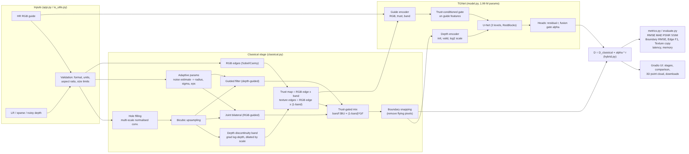

# DepthSR - Edge-Preserving Depth Map Upsampling and Refinement (P4)

**Live demo:** `<HF Space URL>` · **Design doc:** [docs/design.md](docs/design.md) ·
**Results:** [results/eval_P4_T74.md](results/eval_P4_T74.md) · **Ablation:** [results/ablation_nyu.md](results/ablation_nyu.md) ·
**Failure cases:** [results/failure_cases_nyu.md](results/failure_cases_nyu.md)

Turns low-resolution, sparse or noisy depth maps into dense high-resolution depth (x2, x4, x8, x16), using the RGB
image as a guide **only where it marks a real depth boundary** - sharp object edges, no texture copying.



**Pipeline:** hole filling (normalised convolution) -> bicubic -> RGB edges + depth-discontinuity band ->
**trust map** -> trust-gated joint bilateral / guided filtering -> boundary snapping -> **TGNet** (1.99 M param
two-branch guided U-Net) predicts a residual and a per-pixel fusion gate: `D = D_classical + alpha * r`.

## Results (NYU Depth V2, 449 unseen test images, RMSE in cm)
`<paste the table "Performance across upsampling factors" from results/eval_P4_T74.md>`

## Quick start
```bash
pip install -r requirements.txt
python app.py                      # http://localhost:7860
# or
docker build -t depthsr . && docker run -p 7860:7860 depthsr
python tests/test_pipeline.py      # smoke tests
```

## Reproduce training and evaluation
On a GPU machine or the free Kaggle T4 (`notebooks/kaggle_train_eval.ipynb` does all of this):
```bash
wget http://horatio.cs.nyu.edu/mit/silberman/nyu_depth_v2/nyu_depth_v2_labeled.mat
python scripts/prepare_nyu.py --mat nyu_depth_v2_labeled.mat --out data     # split 900/100/449
python scripts/train.py --data data --iters 15000 --bs 16                   # -> checkpoints/tgnet.pt
python scripts/evaluate.py --dataset nyu --data data --team T74 --usns "1RUA24CSE0186,1RUA24CSE0197,1RUA24CSE0208,1RUA24CSE0209"
python scripts/evaluate.py --dataset middlebury --data middlebury --scales 2,4,8   # unseen domain
```
Seeds are fixed (training seed 0, degradation seed = image index), so the numbers are reproducible.

## Repository layout
```
app.py                 Gradio app (validation, pipeline stages, comparison, 3D view, downloads)
depthsr/io_utils.py    loading depth (png16/KITTI/8-bit/npy/pfm/tiff), validation, colouring
depthsr/degrade.py     degradation protocol (downsample, noise, holes, sparsity)
depthsr/classical.py   baselines, hole filling, adaptive params, JBU, guided filter, edges, trust map, snapping
depthsr/model.py       TGNet
depthsr/hybrid.py      DepthSR: runs any of the 8 methods
depthsr/metrics.py     RMSE, MAE, PSNR, SSIM, boundary RMSE, edge F1, texture copy
depthsr/data.py        training dataset with on-the-fly degradation
scripts/               prepare_nyu.py, train.py, evaluate.py
docs/                  design.md, architecture.mmd/.png
results/               eval_P4_T74.md, ablation, failure cases, figures, train log
```

## Methods compared
| Family | Methods |
|---|---|
| Interpolation | nearest, bilinear, bicubic |
| Classical refinement | joint bilateral upsampling, guided filter, our classical pipeline |
| Deep learning | TGNet without classical stage (bicubic input) |
| Hybrid | classical stage + TGNet + fusion gate |

## Limitations
Trained on indoor Kinect data only; outdoor LiDAR is out of distribution. Synthetic degradation is simpler than
real sensor noise. Same-colour foreground/background boundaries cannot be recovered from RGB. See
[design doc §12-13](docs/design.md) for limitations and ethics.

## Datasets
NYU Depth V2 (Silberman et al., ECCV 2012), Middlebury 2005 stereo (Scharstein & Pal, CVPR 2007).
