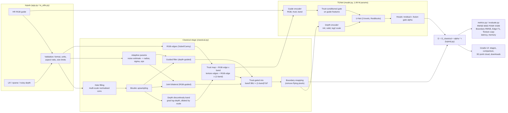

# Design Document - P4: Edge-Preserving Depth Map Upsampling and Refinement

Team: T74 | USNs: 1RUA24CSE0186, 1RUA24CSE0197, 1RUA24CSE0208, 1RUA24CSE0209 | Live app: https://depthsr-t74.streamlit.app | Repo: https://github.com/krishgarg0o/depth-sr

## 1. Problem statement
Depth sensors (ToF, structured light, LiDAR) give depth maps that are **low resolution, sparse, noisy and
have missing values**, while the RGB camera gives a sharp high-resolution image. Naive interpolation blurs object
boundaries and creates "flying pixels" (points floating between foreground and background), and naive RGB-guided
filtering **copies RGB texture into the depth** (e.g. a striped shirt becomes bumpy). The goal is a system that
reconstructs dense HR depth at x2/x4/x8 (also x16), preserving boundaries and discontinuities without texture
copying, and deployed as a public app.

## 2. Goals and non-goals
**Goals:** support multiple upsampling factors, handle missing/noisy/sparse depth, use RGB guidance without texture
copying, compare interpolation / classical / DL / hybrid, measure boundary accuracy, fit a ~10 s CPU latency budget.
**Non-goals:** monocular depth estimation from RGB alone (only used as an optional pseudo-GT demo mode),
metric depth on outdoor LiDAR at scale (KITTI is not used for training; see Limitations).

## 3. Requirements traceability
| Brief requirement | Where it is implemented |
|---|---|
| Nearest / bilinear / bicubic baselines | `classical.interpolate`, `upsample_with_holes` |
| Joint bilateral filtering | `classical.joint_bilateral` (OpenCV ximgproc, numpy fallback) |
| Guided filtering | `classical.guided_filter` (He et al., box-filter implementation) |
| Edge detection + boundary-aware refinement | `rgb_edges`, `trust_map`, trust-gated mix in `classical_refine` |
| Depth discontinuity detection | `depth_discontinuities` (gradient of log-depth, scale invariant) |
| Noise removal and hole filling | `fill_holes` (normalised convolution), guided filter, `estimate_noise` |
| Depth SR network with RGB guidance | `model.TGNet` (two-branch guided U-Net) |
| Fine-tune / train on depth dataset | `scripts/train.py` on NYU Depth V2 |
| Combine interpolation + edge-aware filtering + DL | `hybrid.DepthSR` (classical init -> residual -> gate) |
| Prevent oversmoothing and texture copying | trust map, guide gate, boundary-weighted + gradient loss, TextureCopy metric |
| Multiple factors 2x/4x/8x | single network conditioned on log2(scale); trained on {2,4,8,16} |
| Missing / noisy depth | degradation protocol (`degrade.py`) + robustness protocol in evaluation |
| Compare 4 families | `scripts/evaluate.py` (8 methods, 4 families) |
| Unseen depth maps | NYU test split (449 imgs never trained on) + Middlebury 2005 (different sensor/domain) |
| Boundary performance | BoundaryRMSE, EdgeF1, zoomed boundary figures, 3D point cloud view |
| Latency + memory | measured per method in `evaluate.py` and shown live in the app |

## 4. System architecture

Source: `docs/architecture.mmd`. Module map:
`io_utils.py` (load/validate) -> `classical.py` -> `model.py` -> `hybrid.py` (orchestration) -> `metrics.py`,
`app.py` (UI), `scripts/` (data, training, evaluation).

## 5. Data
* **NYU Depth V2 (labeled, 1449 RGB-D pairs, Kinect, indoor)**. Standard guided-DSR split: images 0-899 train,
  900-999 validation (model selection), 1000-1448 test (449 images, used only for final numbers).
  8 px invalid border cropped -> 464 x 624.
* **Middlebury 2005** (Art, Books, Dolls, Laundry, Moebius, Reindeer; disparity GT, stereo-based): used only for
  testing generalisation to a different sensor, domain and units.
* **Synthetic scenes** (`synthetic.py`): unit tests and CPU sanity checks; contain RGB textures that are absent
  from the depth, to measure texture copying.

**Degradation protocol** (`degrade.py`): bicubic downsampling by s (clean protocol, comparable to the
literature); the noisy protocol additionally adds depth-proportional Gaussian noise (sigma = 2 %) and random
elliptical holes (4 % of pixels). Sparse mode keeps N random points (depth-completion setting).

## 6. Method
### 6.1 Classical stage (all non-learned, explainable)
1. **Hole filling** - multi-scale normalised convolution: G*(d m) / G*m with doubling sigma, only missing pixels
   are written, so measurements are never altered. Also densifies sparse input.
2. **Adaptive parameter selection** - noise level estimated by MAD of the Laplacian of log-depth; the JBU spatial
   radius grows with the scale factor, colour sigma and guided-filter eps grow with the noise level.
3. **Discontinuity band** - gradient magnitude of log-depth (relative jumps, so it works at any depth range),
   dilated by about `scale` pixels because the true edge lies within that distance of the blurred LR edge.
4. **Trust map** - `RGB edge x band`. RGB edges inside the band are real object boundaries; RGB edges outside it
   are texture and are suppressed (`texture = RGB edge x (1 - band)`).
5. **Trust-gated refinement** - `band * JBU(RGB guide) + (1 - band) * GuidedFilter(depth guide)`: sharp RGB-guided
   edges only where a depth edge exists, depth-only smoothing elsewhere (no texture copying).
6. **Boundary snapping** - in strong-discontinuity regions each pixel is snapped to the local foreground (min) or
   background (max) depth, removing flying pixels.

### 6.2 Deep learning stage - TGNet (1.99 M parameters, 7.6 MB)
* Depth encoder: classical depth (normalised by its 99th percentile, so it is unit/scale invariant),
  validity mask, log2(scale) plane.
* Guide encoder: RGB, trust map, band.
* **Trust-conditioned gate**: sigmoid(conv(trust, band, guide features)) multiplies the guide features before
  fusion, so the network learns where RGB is reliable.
* 3-level U-Net with residual blocks; heads output a **residual r** and a **fusion gate alpha**.
* Output `D = D_classical + alpha * r`. alpha is the adaptive mechanism that selects / combines classical and
  learned outputs per pixel (visualised in the app).
* Loss: boundary-weighted L1 (x5 near GT discontinuities) + 0.5 gradient-L1 (penalises both blurred edges and
  spurious texture gradients).
* Training: random 256 px crops, random scale {2,4,8,16}, random noise (50 %), holes (30 %), horizontal flips;
  25 % of samples are fed **without** the classical stage (bicubic input, zero trust maps). This makes the same
  network act as the "DL only" baseline. AdamW, OneCycle LR 2e-4, 6000 iterations, batch 8, fp32
  (a first run with fp16 mixed precision and LR 5e-4 overflowed after ~600 iterations; we switched to fp32, bounded the
  residual with 0.5*tanh and skip non-finite batches). Best checkpoint by validation RMSE: 52.5 % lower than its input.

### 6.3 Why hybrid
The classical stage already delivers sharp, texture-free boundaries cheaply, so the network only learns a
correction (easier, smaller, more data-efficient on 900 training images). Classical outputs are interpretable
(every intermediate map is shown in the UI), the network fixes what hand-tuned filters cannot (thin structures,
colour-ambiguous edges, slanted surfaces).

## 7. Evaluation protocol
Metrics on valid GT pixels (`metrics.py`): RMSE, MAE (cm on NYU), PSNR and SSIM (depth normalised by GT max),
**Boundary RMSE** (5 px band around GT discontinuities), **Edge F1** (2 px tolerance), **Texture copy**
(spurious depth gradient on flat but textured regions), latency (ms/image) and peak memory (fresh process RSS).
Factors x2, x4, x8, x16 on the first 100 test images (NYU 1000-1099); noisy+holes protocol at x4/x8 and the ablation on
30 of them (time budget). The Middlebury download was refused (HTTP 403), so cross-dataset results are not reported.
Results: `results/eval_P4_<TEAM>.md`, `results/eval_middlebury.md`, figures in `results/figs/`.

## 8. Results summary
RMSE in cm, 100 unseen NYU test images (full tables: results/eval_P4_T74.md).

| Method | x2 | x4 | x8 | x16 | x4 noisy | x8 noisy |
|---|---|---|---|---|---|---|
| Bicubic | 1.54 | 3.23 | 5.82 | 9.56 | 61.89 | 61.45 |
| Joint bilateral | 1.72 | 3.35 | 5.52 | 8.63 | 6.26 | 8.44 |
| Classical pipeline (ours) | 3.62 | 4.72 | 6.44 | 9.07 | 7.20 | 9.07 |
| TGNet only | **1.25** | **2.50** | **4.36** | 7.02 | 22.88 | 23.72 |
| **Hybrid (ours)** | 1.81 | 2.79 | 4.47 | **6.88** | **5.49** | **7.26** |

The hybrid beats every interpolation and classical method from x4 upwards (x8: 4.47 vs 5.52 cm for JBU, edge F1 0.889 vs
0.761), is best at x16 and is the clear winner on noisy depth with holes (12-14 % below JBU, 3-4x below TGNet alone).
TGNet alone is most accurate on clean input at x2-x8, because the classical stage's snapping/smoothing slightly hurts
already-clean depth. At x2 even bicubic (1.54) beats the hybrid (1.81).

## 9. Ablation
See `results/ablation_nyu.md`. Removed components: trust map/gating, hole filling, boundary snapping, fusion gate;
plus classical-only and DL-only (30 images, x4 and x8, clean and noisy). The **trust map / gating** contributes most on clean
input (removing it: +9-28 % RMSE, +18-48 % texture copying); **hole filling** is essential on incomplete depth (without it
RMSE rises from 5.5 to 55 cm); boundary snapping slightly increases RMSE (1-2 % lower when removed) but raises edge F1 on
clean x4 (0.970 vs 0.951); the fusion gate gives a small, consistent gain (0.4-1.6 %).

## 10. Failure analysis
See `results/failure_cases_nyu.md` (the three worst test images with error maps, statistics and likely causes).
Known failure modes: thin structures that vanish at x8/x16, boundaries between objects of the same colour (no RGB
edge), dark RGB, glass/mirrors where Kinect GT is itself wrong, and very large depth ranges.

## 11. Deployment
Streamlit app (`streamlit_app/app.py`) on Streamlit Community Cloud (free CPU, deploys from GitHub on every push);
a Gradio version (`app.py`) with a Dockerfile is kept for local/Docker use. (Hugging Face Spaces now requires PRO for
Gradio/Docker Spaces, so it was not used.) Input validation for file type, depth
units, bit depth, colour-image-as-depth, aspect-ratio mismatch, too-small/too-large images (auto-resized to
<= 960 px). Progress bar, clear error messages, examples from the unseen test set, 3D point-cloud comparison,
16-bit PNG / .npy download. Reproducible with `docker build` or `pip install -r requirements.txt && python app.py`.
No secrets are needed or committed.

## 12. Limitations
* Trained only on indoor Kinect data (NYU, 0.5-10 m); outdoor LiDAR (KITTI) with very sparse, line-pattern input
  is out of distribution - sparse mode works but is not tuned for it.
* Synthetic degradation (bicubic + Gaussian noise) is simpler than real sensor noise (multipath, IR saturation).
* If foreground and background share colour, RGB guidance cannot locate the boundary.
* Our classical pipeline alone is worse than bicubic on clean input; it only pays off on noisy/incomplete depth.
* Cross-dataset generalisation (Middlebury) could not be measured: the dataset server refused the download.
* NYU GT depth is itself inpainted (colourisation method) in places, which biases metrics near holes.
* RGB-only mode uses Depth Anything V2 pseudo ground truth, so its metrics show upsampling quality, not metric accuracy.

## 13. Ethics
Depth data of indoor scenes can reveal private spaces and people's body shape; the app does not store uploads
(processed in memory, temporary files only) and uses public research datasets under their licences. Depth
maps used for robotics/AR safety decisions must not rely on this demo without validation - errors concentrate
at boundaries, exactly where collisions happen. Model and data are documented so results can be reproduced and
audited.

## 14. Team responsibilities
| Member | Owns | Explains in viva |
|---|---|---|
| M1 | `classical.py`, `degrade.py` | hole filling, JBU vs guided filter, trust map, adaptive params |
| M2 | `model.py`, `data.py`, `train.py` | TGNet, gates, loss, training, DL-only baseline |
| M3 | `metrics.py`, `evaluate.py` | metrics, protocols, ablation, failure cases |
| M4 | `app.py`, Dockerfile, docs | deployment, input handling, demo flow |
