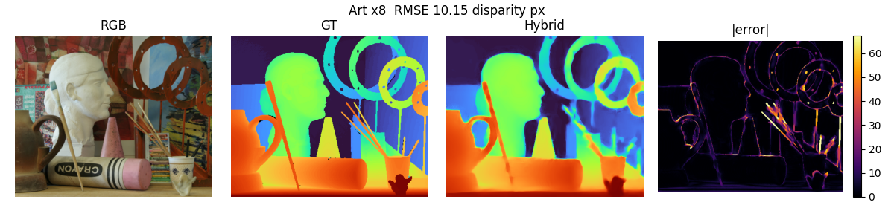
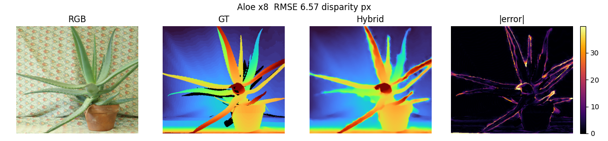
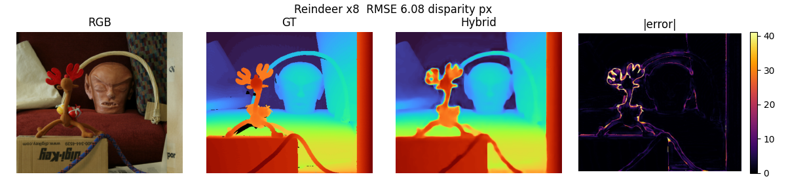

# Failure cases (middlebury)

The three test images with the highest hybrid RMSE. Causes are inferred from image statistics compared with the dataset median (see describe()/guess_cause() in scripts/evaluate.py) and should be confirmed by looking at the figures.

## 1. Art (x8) - RMSE 10.15 disparity px, boundary RMSE 16.28

Likely causes:
- many depth discontinuities / thin structures (chair legs, plants, cables) that disappear completely in the low-resolution input
- dark / low-contrast RGB so object boundaries are not visible in the guide image

Stats: brightness=97.528, rgb_edge_density=0.164, depth_disc_density=0.088, depth_range=149.000, near_far_ratio=2.756

## 2. Aloe (x8) - RMSE 6.57 disparity px, boundary RMSE 11.26

Likely causes:
- many depth discontinuities / thin structures (chair legs, plants, cables) that disappear completely in the low-resolution input
- heavy RGB texture (shelves, books, patterned surfaces): colour guidance becomes ambiguous

Stats: brightness=169.437, rgb_edge_density=0.353, depth_disc_density=0.081, depth_range=168.000, near_far_ratio=3.267

## 3. Reindeer (x8) - RMSE 6.08 disparity px, boundary RMSE 12.83

Likely causes:
- dark / low-contrast RGB so object boundaries are not visible in the guide image

Stats: brightness=73.835, rgb_edge_density=0.106, depth_disc_density=0.044, depth_range=189.000, near_far_ratio=2.955
