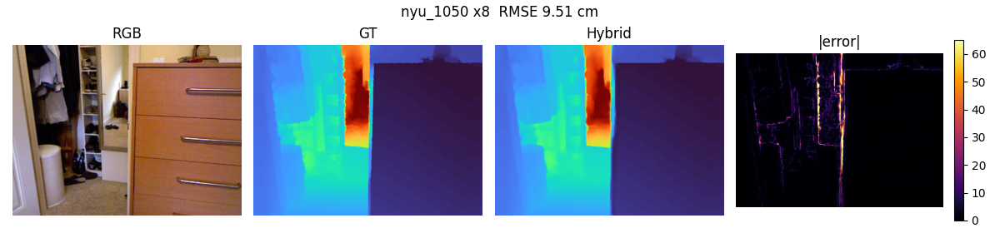

# Failure cases (nyu)

The three test images with the highest hybrid RMSE. Causes are inferred from image statistics compared with the dataset median (see describe()/guess_cause() in scripts/evaluate.py) and should be confirmed by looking at the figures.

## 1. nyu_1015 (x8) - RMSE 23.58 cm, boundary RMSE 57.60

Likely causes:
- many depth discontinuities / thin structures (chair legs, plants, cables) that disappear completely in the low-resolution input
- dark / low-contrast RGB so object boundaries are not visible in the guide image

Stats: brightness=57.815, rgb_edge_density=0.124, depth_disc_density=0.045, depth_range=6.307, near_far_ratio=5.007

## 2. nyu_1014 (x8) - RMSE 9.72 cm, boundary RMSE 28.59

Likely causes:
- many depth discontinuities / thin structures (chair legs, plants, cables) that disappear completely in the low-resolution input
- dark / low-contrast RGB so object boundaries are not visible in the guide image
- very large depth range (window / corridor): far values have large absolute errors

Stats: brightness=53.003, rgb_edge_density=0.113, depth_disc_density=0.021, depth_range=8.467, near_far_ratio=5.576

## 3. nyu_1050 (x8) - RMSE 9.51 cm, boundary RMSE 27.41

Likely causes:
- many depth discontinuities / thin structures (chair legs, plants, cables) that disappear completely in the low-resolution input
- very large depth range (window / corridor): far values have large absolute errors

Stats: brightness=108.926, rgb_edge_density=0.118, depth_disc_density=0.024, depth_range=5.824, near_far_ratio=7.965
